<div align="center">

<!-- Animated hacker-style header (assets/header.svg) -->


<a href="https://git.io/typing-svg">
  
</a>

<br/><br/>


</div>


## `~/about-me`

```python
class Developer:
    def __init__(self):
        self.name = "Santosh Kumar Meher"
        self.role = "Software Developer"
        self.focus = ["Web", "Cloud", "Mobile Apps"]
        self.languages = ["Python", "Dart", "JavaScript", "Java", "C"]
        self.currently_learning = "New technologies, every single day"
        self.motto = "Code. Learn. Improve. Repeat."

    def mission(self):
        return "Solve real-world problems with Python & modern tech, and ship scalable, useful products."

me = Developer()
print(me.mission())
```

<div align="center">

| 💻 Web, Cloud & Mobile | 🧠 Problem Solver | 📚 Lifelong Learner | 🎯 Product Focused |
|:---:|:---:|:---:|:---:|
| Full stack builds | Python & modern tech | Always exploring | Scalable & useful |

</div>


## `~/tech-stack`

<div align="center">

**⚙️ Programming & Backend**


**🌐 Frontend & UI**


**☁️ Database & Cloud**


**🧰 Tools & AI/ML**


**🎨 Graphic Design & Animation**


**🖥️ Operating Systems**


</div>


## `~/featured-skills`

<div align="center">


</div>


## `~/github-stats`

<div align="center">


<br/>


<br/>


<br/>


</div>


## `~/contribution-snake`

<div align="center">

<picture>
  <source media="(prefers-color-scheme: dark)" srcset="https://raw.githubusercontent.com/santoshkumarmeher/santoshkumarmeher/output/github-snake-dark.svg" />
  <source media="(prefers-color-scheme: light)" srcset="https://raw.githubusercontent.com/santoshkumarmeher/santoshkumarmeher/output/github-snake.svg" />
  
</picture>

</div>


## `~/connect`

<div align="center">

<a href="https://linkedin.com/in/santoshkumarmeher"></a>
<a href="https://twitter.com/santoshkmeher"></a>
<a href="https://www.youtube.com/@santoshkumarmeher"></a>
<a href="https://instagram.com/meherphotographer"></a>
<a href="https://fb.com/kumarsantoshmeher"></a>

<br/><br/>

### 💡 *"Code. Learn. Improve. Repeat."*

⭐ **If you like my work, consider giving a star!** ⭐


</div>
